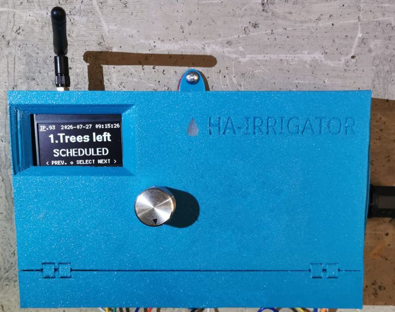
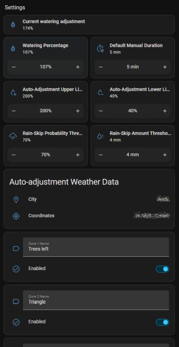
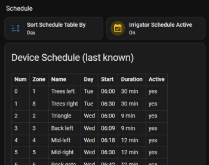

# HA-Irrigator

## What is it?

An intuitive and human-friendly irrigation controller: 11 sprinkler zones + a shared pump, driven by a rotary-encoder + OLED local UI and a full MQTT API for Home Assistant integration. 

### Top differentiation points
- Human-friendly intuitive control on device and via Home Assistant.
- Flexible watering control — your command is never lost, your garden is never dry.
- Automatic watering adjustment based on the weather. Yes, it saves water when it rains!
- 110-240VAC pump control directly from the device, no extra contactors or relays.
- External antenna mount for placement wherever you want.
- Malfunction detection for the pump and valves: it protects your garden and your pocket from drying out.
- No battery! No chemical leaks, no device damage.
- Optional Home Assistant integration — works out of the box. It gives you:
  - Human-readable names for the irrigation zones.
  - Irrigation logging.
  - Remote control and status review.
  - Comfortable schedule building and editing.

## Why HA-Irrigator?

HA-Irrigator fixes the traditional shortcomings of industrial watering control systems.

| Trouble | Solution |
|---|---|
| 1.5V or 9V battery - the settings, the schedule, and the clock are backed up with regular batteries. You never know when the battery will die and leak into the device. And when the battery is dead and the mains power fails, you lose the whole schedule. This forces you to stand again in front of your irrigator, recall what the program was, and configure everything from scratch. | We keep all the settings and schedule in non-volatile memory. It does not require a battery. The clock runs on a battery that lasts 10 years and NEVER leaks. Your device is a safe investment, and your precious time is saved: no more re-configurations. |
| You cannot really manage any irrigator without reading manuals and standing in front of the device for a long time. | HA-Irrigator is intuitive! It requires zero configuration in front of the device. And when you approach it for manual commands, it helps you with on-screen hints. |
| Some irrigators have built-in or added Wi-Fi modules. But the Wi-Fi has a hidden antenna. This forces the owner to place the irrigator somewhere with decent Wi-Fi signal reception. | HA-Irrigator has an external SMA antenna connector. The owner is free to connect the antenna directly to the irrigator, or relocate it using a long enough coaxial cable to place the antenna in an area with good signal reception. |
| You never know if an industrial irrigator followed your program. You only find out once your garden dries up and dies. | HA-Irrigator gives you precise logging of what happened and when. |
| You must adjust the watering seasonally. If you forget, your garden suffers from lack of water, or your wallet suffers from excess spending. | HA-Irrigator has weather awareness. You just set a base watering amount per zone, and from there the system takes control: when it's too dry, watering is increased proportionally. When it rains, you save the water (and the cost). |
| Industrial irrigators force you to approach them and stand in front of the device to see its status or configure its programs. | We give you the power to see and change everything from your computer or mobile phone. More than that, it can be integrated with your smart home. So your home can configure the irrigator if you wish. |
| Traditionally, irrigators have at least 4 buttons and/or a dial with weird labels. Confusing and not intuitive. | This device has 1 (only one) knob. You rotate and push it like the volume knob in your car. And it helps you with navigation on the screen if you get lost. |
| Manual control of a normal irrigator is timed out. It takes your command after 10-30 seconds. | HA-Irrigator does not waste your time. Your command is executed immediately. If you don't appreciate half a minute of your life wasted, then this feature is meaningless :) |
| Usually, if you set a different manual command on a normal irrigator, the current watering is aborted. | HA-Irrigator assumes that every command is important. It puts all your commands in line. When the command's turn arrives, it is executed. Just fire and forget. |
| Industrial irrigators have a limit on programs, and a limit on entries per program. Why? | We hate limits. Feel free to build the weirdest schedule ever, we accommodate that! |
| Even if an off-the-shelf irrigator provides "smart" access and features, it only works if you're close to it (over Bluetooth) or over the vendor's remote server (forget your privacy!) | HA-Irrigator is your private system: you run it, access it as you want, configure it — you're in control! |

## Feature overview

- **11 independently-named sprinkler zones** plus pump-only runs, with the pump always
  pre-started ~500ms before a valve opens and kept on for a 60s graceful-shutdown window after a
  valve closes (protects the pump from rapid-cycle wear) — if another watering is queued up, it
  hands off to the still-running pump immediately instead of waiting out that window. Each zone
  can also be individually disabled (`settings.json`'s `zone_names.<n>.enabled`) to exclude it
  from scheduled, manual, and MQTT-triggered watering alike — an MQTT `cmd/run` against a disabled
  zone is rejected with a `/alert` instead of running, and the local UI's manual zone picker (see
  below) skips disabled zones entirely so they can't be dialed up in the first place.
- **Weekly schedule** (`schedule.json`, almost endless count of records) with a per-zone watering-percentage
  multiplier, a pause/rain-skip mechanism, and a 15-deep queue so overlapping or MQTT-triggered
  runs during an active watering don't get lost — they queue and run in order, back-to-back on
  the same pump cycle whenever the pump is still spinning down from the previous one.
- **Local UI**: 2.4-inch OLED display and knob, auto-dimming after 20s of inactivity, full menu for stopping, viewing/adjusting the schedule, and settings.
- **MQTT**: Key feature, allowing you to connect HA-Irrigator to practically any smart home system. Provides status/availability reporting (Home-Assistant-compatible LWT), remote run/stop/schedule control, current-fault alerting, OTA updates, calibration, and file backup.
- **Captive-portal setup**: first boot (or after a factory-reset-style config wipe) serves a
  Wi-Fi AP with a setup page; it tests both Wi-Fi *and* MQTT connectivity before committing the new config, and rolls back to AP mode if either fails.
- **DS3231-backed clock** with NTP sync and automatic EU DST switching (last Sunday of March/October, 01:00 UTC).
- **Weather-based auto-adjustment**: once the device knows its location (auto-detected via
  ip-api.com, no setup needed), it fetches a forecast (Open-Meteo, with a WeatherAPI.com fallback)
  a few hours ahead of your first scheduled watering each day, skips the day's scheduled runs
  entirely when meaningful rain is forecast, and otherwise nudges the watering percentage up in
  hot weather / down after recent rain — all within a configurable lower/upper bound. See
  [docs/usage_irrigator.md](docs/usage_irrigator.md) and [docs/technical.md](docs/technical.md).
- Name your zones. Numbers are nice, but words work better for people.
- Configurable time for testing of all zones.

## Device

## Screenshots

### Status and manual control

### Settings

### Schedule

See more screenshots in [User guide for HA](docs/usage_homeassistant.md).

## Useful (further reading)
- [User guide of the HA-Irrigator](docs/usage_irrigator.md), including installation instructions.
- [User-guide for HA integration](docs/integration.md).
- [User guide for HA](docs/usage_homeassistant.md).
- [Technical explanations](docs/technical.md) (for geeks only).
- [OTA firmware upgrade](docs/ota.md) (for makers only).
- [Hardware](hardware/readme.md).