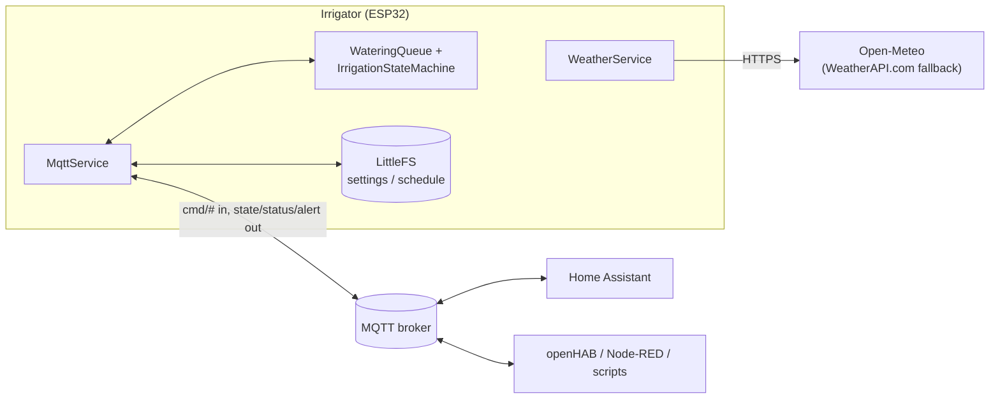
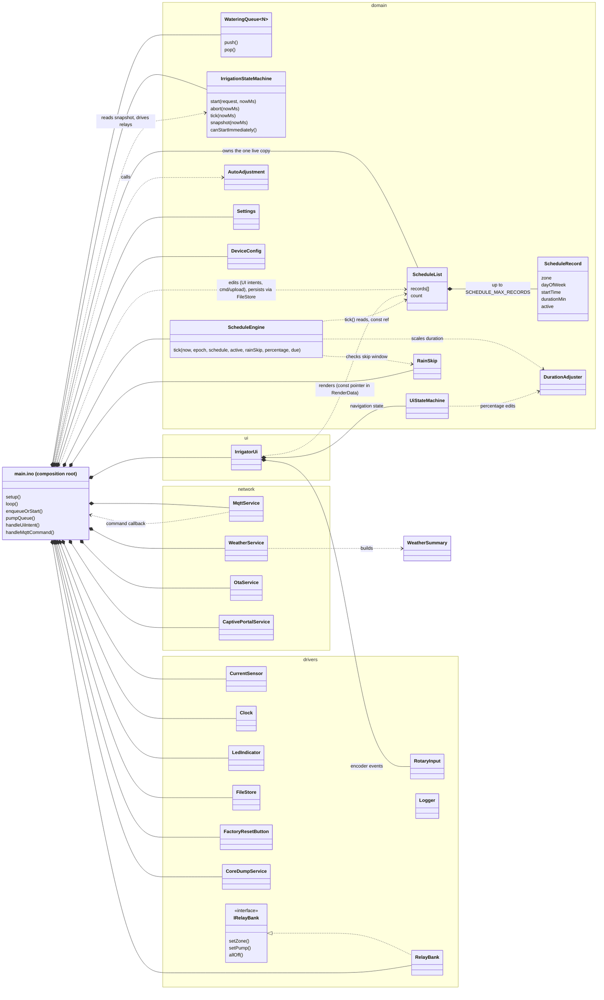
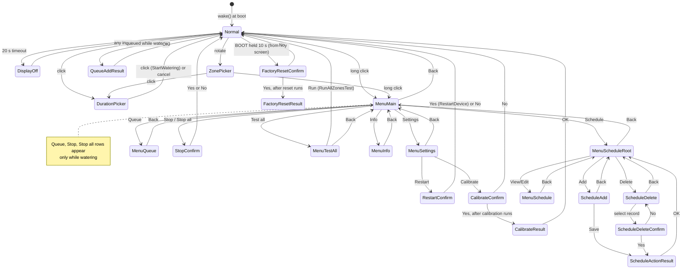
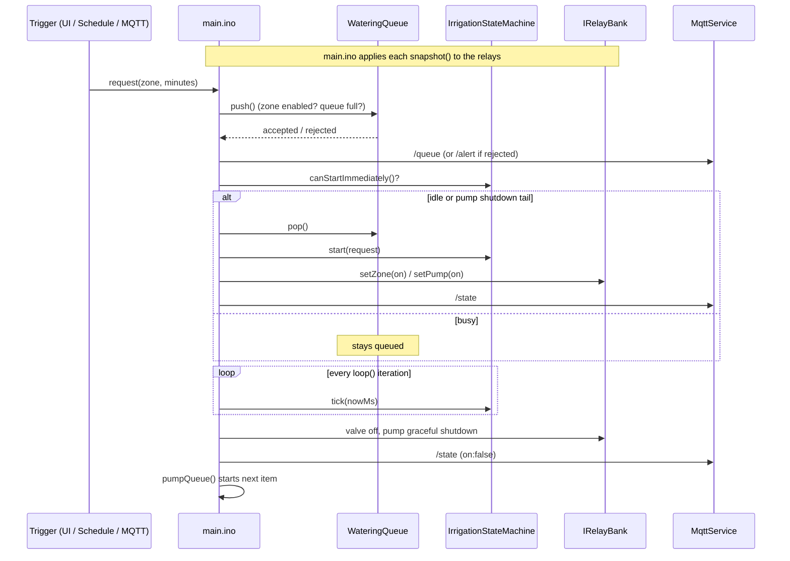

## Firmware architecture

The codebase enforces a strict layering — hardware access, business logic, networking, and UI
rendering are never mixed in the same function or file:

- **`src/drivers/`** — thin wrappers around individual physical peripherals (relay outputs, the
  DS3231 RTC, the SSD1309 display, rotary encoder + button input, the ADC current sensors). This is
  the *only* layer allowed to call `Wire.h`, `digitalWrite`, `analogRead`, or similar direct
  hardware APIs, and each driver exposes a small interface (e.g. `IClock`, `ICurrentSensor`) rather
  than a concrete type.
- **`src/domain/`** — pure C++ business logic: the irrigation state machine, the UI/menu state
  machine, the schedule queue, the duration-adjustment formula, current-fault threshold checks.
  This layer only ever depends on the driver *interfaces*, never on `Arduino.h` or a concrete
  Arduino type directly — that's what makes host-run unit testing possible (see **Testing**,
  below).
- **`src/network/`** — Wi-Fi connection handling, the captive portal, the MQTT client wrapper,
  OTA, NTP sync.
- **`src/ui/`** — display rendering and encoder input dispatch. Reads state from `domain/`; never
  contains irrigation logic itself.
- **`include/board_config.h`** — all pin numbers, I2C addresses, and board-specific constants (see
  **Hardware**, above).

A few architectural rules worth knowing before touching the code (see [agents.md](../agents.md)
for the full, non-negotiable list this project holds itself to):

- **Composition root, not scattered globals.** Every long-lived object (relay bank, RTC, display,
  MQTT client, Wi-Fi manager, the irrigation state machine) is instantiated exactly once, in
  `main.cpp`, and passed by reference/pointer into whatever needs it.
- **The watering queue is the choke point, not a side buffer.** What *does* hold the architecture together is `main.ino`'s watering queue:
  a manual start from the rotary UI, a scheduled run firing due, an MQTT `cmd/run`, and "Test all
  zones" queuing up every enabled zone all funnel through the exact same
  `enqueueOrStart()` → `WateringQueue::push()` → `pumpQueue()` → `WateringQueue::pop()` path — even
  a request that can start immediately gets pushed and immediately popped back off, rather than
  short-circuiting straight into `startIrrigation()`. That's a deliberate, if non-obvious, choice:
  - **One choke point enforces every invariant.** Whether a zone is disabled, whether the queue is
    full, and whether it's actually safe to start right now (idle, or mid pump-graceful-shutdown
    for a seamless hand-off — `IrrigationStateMachine::canStartImmediately()`) are each checked in
    exactly one place. A design where manual/scheduled/MQTT triggers each decided "start now vs.
    reject" independently would need that same logic duplicated (and kept in sync) at every call
    site — a natural place for one path to drift and skip a check the others still enforce.
  - **Reporting is uniform for free.** Every request gets both a push report and a pop report,
    even the common case of starting immediately with nothing else running — callers never need
    a separate "started immediately" vs. "queued" code path.
  - **The rotary UI can lean on it too.** `UiStateMachine::handleNormal` no longer gates rotation/
    click on `Context::wateringActive` — turning the knob while a run is already active picks a
    zone/duration exactly like the idle case, and `UiIntent::boolValue` flags that the resulting
    `UiIntentType::StartWatering` was made while watering, so `main.ino`'s `handleUiIntent` knows to
    report the push outcome back via `IrrigatorUi::showQueueAddResult()` (`UiScreen::QueueAddResult`
    — "Added to queue"/`QUEUE FULL`) instead of assuming an immediate start. This is only possible
    because every request already goes through the queue regardless of whether it can start right
    away — the UI change didn't need any new backend plumbing.
  - **Overlapping requests are just... next in line.** Because "arriving" and "starting" are
    already two separate steps, a schedule firing while an MQTT run is active, or "Test all zones"
    handing over 11 zones at once, don't need special-cased merge logic — they queue up and drain
    back-to-back through the same `pumpQueue()` call, in order.
  - **It's fully unit-testable.** `WateringQueue` and `IrrigationStateMachine` are pure `domain/`
    code with no hardware dependency, so the entire "can this start now, and what happens to
    everything behind it" logic is covered by the native test suite (see **Testing**, below)
    rather than only being verifiable on real hardware.
- **Fail loud, not silently plausible.** Malformed or out-of-range data (a bad `schedule.json`, an
  out-of-range MQTT command) is rejected and alerted on, never clamped or defaulted into something
  that looks reasonable — it's better for the device to stay idle than to water the wrong zone (or
  the right zone for the wrong duration) from corrupted data.


## Integration architecture

The device has no cloud dependency and no vendor API: its **only** integration surface is MQTT against a broker on the local network. Also the network connectivity is optional for automatic irrigation adjustment and for smart home control. Every critical or main oprtation can be done on the Irrigatior UI.

The Irrigator communication is open: any system that can publish and subscribe to MQTT topics (Home Assistant, openHAB, Node-RED, ioBroker, a `mosquitto_pub` script) can monitor and control it the same way. The broker is optional — without one the device still waters from its stored schedule and local rotary UI.




### Topic contract

All topics are prefixed `irrigator<xx>` (last two hex digits of the MAC). The full per-topic
payload reference is in [technical.md](technical.md#mqtt); the integration-relevant shape is:

| Direction | Topics | Purpose |
|--|--|--|
| Device → broker | `/online` (retained, LWT) | Availability — `true`/`false`; the broker flips it on an ungraceful disconnect. |
| Device → broker | `/state`, `/queue` | Current valve/pump run and the waiting queue, published on every change. |
| Device → broker | `/status` | Firmware version, uptime, RSSI, MQTT health counters; first publish ~15 s after boot. |
| Device → broker | `/alert` | Faults and rejected commands (over/under-current, bad payload, publish failure). |
| Device → broker | `/scheduled`, `/auto_adjustment`, `/watering_percentage`, `/skip_rain_until` | Echoed settings state. `/scheduled` and `/watering_percentage` are retained so a late subscriber sees them. |
| Broker → device | `/cmd/run`, `/cmd/stop`, `/cmd/queue`, `/cmd/state` | Start/stop watering and request on-demand reports. |
| Broker → device | `/cmd/scheduled`, `/cmd/auto_adjustment`, `/cmd/watering_percentage`, `/cmd/skip_rain_until` | Change settings; the device persists them and echoes the result. |
| Broker → device | `/cmd/upload/<file>`, `/cmd/download/<file>`, `/cmd/delete/<file>` | Read/write `settings.json` and `schedule.json` (uploads are merged field by field). |
| Broker → device | `/cmd/calibrate`, `/cmd/restart`, `/cmd/ota`, `/cmd/coredump[_clear]` | Maintenance. |

Design properties an integrator can rely on:

- **Commands are requests, not writes.** A `cmd/run` goes through the same watering queue as the
  rotary UI and the schedule, so the result is observed on `/state` and `/queue` (or `/alert` if
  rejected). The device never trusts a command's side effect to have happened until it publishes
  the echo.
- **The device is the source of truth.** Integrators keep a mirror of settings/schedule (HA caches
  them from `cmd/download/*`) but must treat the echoed topics as authoritative.
- **Invalid input is rejected, not repaired.** Out-of-range zones, malformed JSON, or bad
  durations produce an `/alert` and no action (see *Fail loud* above).
- **Watch `/online`.** Mark entities unavailable when it is `false`; QoS 0 commands sent while the
  device is mid Wi-Fi-reconnect can be dropped, so confirm via the echo topic.

### Home Assistant

Home Assistant integrates through its stock **MQTT integration** plus a ready-made *package* in
[`homeassistant/`](../homeassistant/) — there is no MQTT-discovery publishing from the firmware.
The package declares MQTT switches/sensors/numbers for each zone and setting, automations that
translate dashboard actions into `cmd/*` publishes, and a dashboard tab (status, history, schedule
editor, settings). Install steps are in [integration.md](integration.md).

### Other systems

Anything else needs only the topic contract above: subscribe to `irrigator<xx>/#`, publish to
`irrigator<xx>/cmd/...`, e.g.

```
mosquitto_pub -t irrigatorF4/cmd/scheduled -m false
mosquitto_sub -t 'irrigatorF4/#' -v
```

## Firmware UML chart

Ownership and dependencies, as wired in the composition root (`main.ino`). Domain classes depend
only on driver *interfaces*; concrete drivers and network services are held by `main.ino`, which
glues events between them.



`IrrigationStateMachine` never touches `IRelayBank`: it only computes a snapshot, and `main.ino`
applies that snapshot to the relays. This keeps the state machine free of any driver dependency.

### UI navigation state machine

`UiStateMachine` is pure navigation logic: it consumes `UiInputEvent`s (rotation, click, long
click) plus a `Context` of live values, changes the current `UiScreen`, and returns a `UiIntent`
that `main.ino` executes. `IrrigatorUi` renders the screen and owns the rotary input. Every state
except `DisplayOff` falls back to `DisplayOff` after 20 s without input, and a 10 s hold on the BOOT
button forces `FactoryResetConfirm` from anywhere.



This was derived from every `screen_ =` assignment in `UiStateMachine.cpp`. Two simplifications:
the exact return screen after `ScheduleActionResult` is recorded per action
(`scheduleResultReturnScreen_`), and `FactoryResetConfirm` can be entered from any screen, not just
`Normal`.

### Request flow: every start goes through the queue



The class diagram is simplified: `Logger`, `CalendarMath`, `DstRules`, `WifiQuality` and similar
helpers are omitted.
