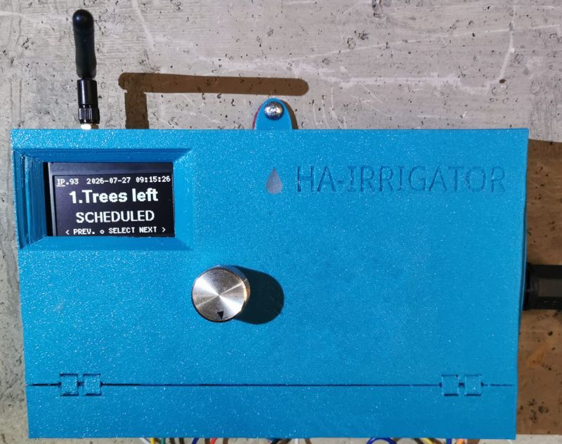
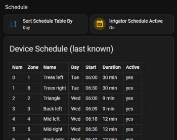
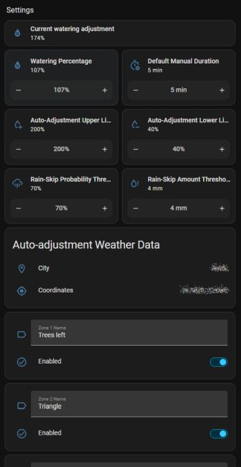

# Home Assistant Usage

This is the end-user guide to the Garden tab once the HA package is installed. For installation
steps (copying files, finding your device's MQTT prefix, troubleshooting a package that won't
load) see [homeassistant/README.md](../homeassistant/README.md) — this page assumes that's done and
focuses on what each part of the dashboard does day to day.

## Status & Manual Control

One card per pump/zone (pump first, disabled zones hidden): a toggle — its label is the zone's
real name, never "Zone N" — and a 1–120 minute duration slider. Flip the toggle on to start a run
for whatever the slider is currently set to; flip it off to stop. A "Remaining" row shows minutes
left on whichever zone/pump is actually running (the device only ever runs one thing at a time).

## History

A 7-day timeline (`history-graph`), one row per zone/pump, showing exactly when each ran.

## Schedule

A read-only table of the device's current weekly schedule, sortable by day/zone/name/start/
duration/active, plus an editor panel below it: pick an existing row (or "+ Add new"), set
zone/day/start time/duration/active, then **Save** or **Delete**. Every edit republishes the whole
schedule to the device — there's no partial update.

## Settings

- **Schedule Active** / **Watering Percentage** — direct controls, same as the device's own rotary menu. Watering Percentage is also the value weather-based auto-adjustment works once a day (see  below) — think of your own edits here as a same-day override, since the next daily cycle  recalculates and overwrites it. Although control on **Watering Percentage** is provided, the HA-Irrigateor takes care about it by Auto-adjustment algorithm.
- **Zone name / Enabled**, one row per zone — renaming or disabling a zone here updates the device  immediately (a disabled zone can't be started manually, by schedule, or via MQTT until  re-enabled). Disabling the zone is useful if you want to protect yourself for mistakes of setting irrelevant schedule. It also temporarily useful when you need to repair an electric or water cisruit of a certain zone or just perform mainenance on it.
- **Default Manual Duration**, **Valve/Pump current calibration** — see
  [docs/technical.md](technical.md)'s **Current-sensor calibration** section for what the  calibration numbers mean and how to derive them.
- **Auto-adjustment** — the master on/off switch for the whole weather-based feature (both the  daily percentage recalculation and the rain-skip check), topmost in the **Auto-adjustment  Weather Data** card. Turning it off freezes watering at whatever **Watering Percentage** is  currently set to — same as if the feature didn't exist — until turned back on. Mirrors the  device's own rotary UI, where it's the first item in the Settings menu.
- **Auto-adjustment Upper Limit** / **Lower Limit** — the range the daily weather-based adjustment  is allowed to move **Watering Percentage** within (defaults 200% / 40%). If the computed value  would fall below **Lower Limit**, that day's watering is skipped entirely (0%) instead of being  clamped up to it. The **Upper Limit** is intended to save an excessive bill on watering, trading off a bit the health of the plants.
- **Rain-Skip Probability Threshold** / **Amount Threshold** — the two thresholds deciding whether a day's watering is skipped entirely because of rain in the forecast (defaults 70% / 4mm):
  probability counts *at or above* its threshold, amount only counts *strictly above* its threshold. See [docs/usage_irrigator.md](usage_irrigator.md)'s **Step 1** for the worked examples.
- **City** / **Coordinates** — read-only, whatever the device auto-detected from its IP address the  first time it came online with no saved location (there's no way to correct these from HA if the  IP-based lookup is inaccurate for your network — see docs/technical.md's **Known limitations**).
  There's no HA equivalent of the device's own "Last update" field — that date lives in the  device's RAM only, never written to `settings.json`, so it's visible on the device's own rotary  UI Settings menu but not in Home Assistant.

## Troubleshooting

Covered in [homeassistant/README.md](../homeassistant/README.md)'s **Troubleshooting** section — most dashboard problems (entities showing "unavailable", zone names stuck at placeholders, wrong entity_id prefixes) share a handful of root causes covered there in depth. For the weather fields specifically: if **City**/**Coordinates** never populate, the device hasn't yet had a successful ip-api.com lookup — check its own Settings menu (rotary UI) or `sensor.irrigator_settings`'s `location_known` attribute; if that's `false`, the device is still retrying every 5 minutes (needs Wi-Fi, and ip-api.com being reachable).
