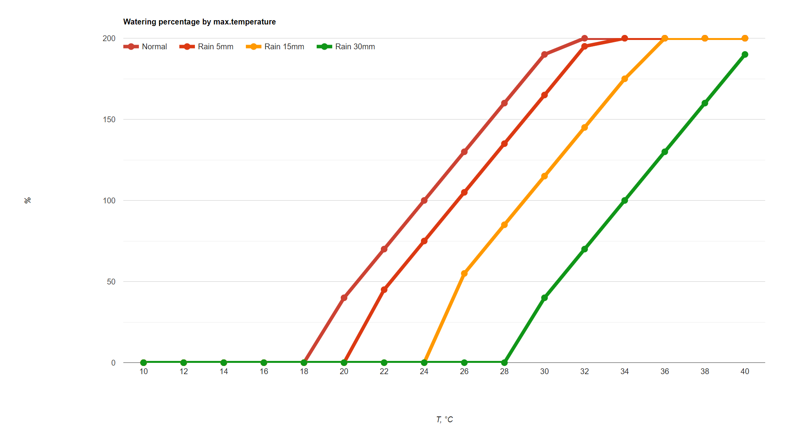

# Using the Irrigator

## What it does

The Irrigator controls up to 11 sprinkler zones (valves) plus a shared pump. You can run any zone
on demand, or set up a weekly watering schedule and let it run itself. It has a small screen and a
turn-and-click knob (rotary encoder) built in, so it works standalone even before you connect it
to anything else.

Integration (pairing) of the Irrigator with Home Assistant benefilts you with:
- Easy configuration and settings update: Zone naming, Scheduling, defaults.
- Ability of remote control of the Irrigator.
- Ability of status observation and historical watering review.
- Sophisticated weather-awareness for automatic adjustment of watering - *not implemented yet*.

If you want to hook it up to Home Assistant afterwards, see
[usage_homeassistant.md](usage_homeassistant.md).

## Connections and wiring

> **Safety first:** everything below the transformer's 24VAC output is low-voltage and safe to
> handle. Everything upstream of it — the mains feed and the pump wiring — is 230VAC. Always
> switch off the breaker feeding the unit before touching any of that, and if you're not
> comfortable working with mains wiring, have an electrician make those connections for you.

Two reference layouts cover most installs:

- **Simple wiring** — one enclosure holds the transformer, power supply, current sensors, and
  the control board together. Easiest to follow if everything fits in one box.
- **Separated eco wiring** — the mains-facing parts (transformer, power supply, current sensors)
  live in their own small enclosure, connected to the control board by a short low-voltage cable.
  Useful if you'd rather keep the ESP32 and relay board away from the mains wiring, or need to
  split things across a tighter space.

### Simple wiring


 ### Separated eco wiring
 This wiring method runs the 24VAC transformer only when pump is running. When valve is open, the pump is active. This saves the energy waste (and the electricity bill) of running the transformer without any load.

 

Either way, the same four things need wiring up: the transformer, the current sensors, the pump,
and the valves.

### Placing the 24VAC transformer

The transformer converts your 230VAC mains supply down to the 24VAC that actually drives the valve solenoids.

- It is recommended to user DIN-rail mount transformer of 15VA at least.
- Mount it in a dry, ventilated spot with the rest of the electronics — a garage or utility
  closet, or inside the same weatherproof enclosure as the control board. Never mount it inside an
  outdoor valve box or anywhere it could get wet.
- Keep it reasonably close to the control board — the run from the transformer's 24VAC output to
  the board should be short, since long thin cable runs droop the voltage the valves see.
- **Primary side (230VAC, mains)**: Live and Neutral from a breaker-protected circuit, wired with
  the breaker off. If the transformer has an earth terminal, connect it to your home's protective
  earth.
- **Secondary side (24VAC)**: two wires, no polarity to worry about since it's AC — these feed the
  board's 24VAC input, which powers the pump relay and all 11 zone relays.

### Wiring the current sensors

- **24VAC current sensor**: pull the 24VAC wire that carries current to whichever valve
  is open — this is the wire between the transformer's 24VAC output and the valves' common
  terminal (see below). It reads the combined draw of whatever zone (or the pump) is currently
  running.
- **230VAC current sensor**: pull the mains Live wire feeding the pump, after the
  pump's relay — so it only reads current while the pump relay has actually switched the pump on.

Two things matter for either sensor to read correctly:
- Thread only **one** of the two wires (just the Live/hot side) through the clamp — if both wires
  of a pair pass through together, their currents cancel out and the sensor reads close to zero.
- Pass the wire through the clamp once (a single loop), not several times, and note the direction
  arrow printed on the sensor if it has one.

Current readings work out of the box — there's nothing to pre-calibrate before they're meaningful.
Calibration is a separate, optional step (Settings > **Calibrate CS**) that teaches the device what
*normal* draw looks like for your specific valves and pump, so it can warn you later if something
draws abnormally more or less than that — see **Current-sensor calibration explained**, near the
end of this document.

### Connecting the zone valves

For wiring of valves it is recommended to use the wries at least 20 AWG or thicker. This ensures minimal voltage drop for distant valves. If your valves are very close to the irrigator, using thinner wires is OK too.

Each sprinkler valve has two wires, and it doesn't matter which is which — it's an AC solenoid,
not polarity-sensitive:

1. Take **one wire from every valve** and join them all together (a wire nut or a terminal block
   works well), then run that single joined wire back to the board's **Valves common** terminal.
   This is the shared return path every zone uses.
2. Take the **other wire from each valve** and run it back individually to that valve's own
   numbered **Zone** terminal on the board (Zone 1 through Zone 11). Only that valve's relay
   switches 24VAC onto its own zone wire, so only it opens when its zone runs.
3. Keep the cable gauge and run length reasonable for the distance involved — solenoids are
   sensitive to undervoltage, and a long thin run to a distant valve can drop the voltage enough
   that it won't reliably open.

### Connecting the pump

The pump runs on 220-240VAC mains, switched through its own relay on the board (unlike the valves,
which run on the low-voltage 24VAC side). Wire the pump's supply through the board's **To Pump**
terminals, with the breaker off while you work, and make sure the circuit feeding it has its own
appropriate mains protection.

## First-time Wi-Fi setup

A brand-new (or freshly reset) unit doesn't know your Wi-Fi yet, so it starts up in **setup mode**:

1. Power it on. The status LED blinks slowly (on/off about every second) and the screen shows a
   network name like `irrigator42_SETUP` along with an address, `192.168.4.1`.
2. On your phone or computer, open Wi-Fi settings and connect to that network
   (`irrigator42_SETUP`). It has no password.
3. Open a web browser and go to `http://192.168.4.1/`. A setup page appears — fill in:
   - Your home Wi-Fi network name and password
   - Your MQTT server details, *only if* you're integrating with Home Assistant — leave the
     defaults if you're not sure, you can always come back and redo setup later

   There's no timezone to pick. Once the Irrigator is on your network it looks up where it is (the
   same lookup that feeds the weather-based watering adjustment) and sets its own clock from that,
   daylight saving included. Until that lookup lands — normally within a minute of the first
   connection — the device is on UTC, so don't be surprised if the time on screen is off for the
   first moment after setup.
4. Submit the form. The Irrigator tries connecting with what you entered. If it works, it saves
   the settings and restarts normally, connected to your home Wi-Fi. If something's wrong (wrong
   password, unreachable server, etc.), it forgets the attempt and goes back to setup mode so you
   can try again.

Once connected, the screen shows the last part of its IP address and the current date/time instead
of the setup network name — that's your sign it's ready to use.

## Reading the screen

During normal operation, the screen looks like this:

```
IP.42    2026-07-11 14:32:07
----
           ZONE 3
      WATERING 4:32
   < PREV. o SELECT NEXT >
```

- **Top line**: last part of the device's IP address, plus the current date and time.
- **Dashes row**: a quick Wi-Fi signal strength meter — 0 dashes means little to no signal, 4
  dashes means excellent. (You can check the exact signal strength in **Info**, below.)
- **Middle line**: what's happening right now — a zone name, `PUMP`, or nothing if idle.
- **Status line**: one of:
  - `IDLE-READY` — nothing running, nothing scheduled soon
  - `SCHEDULED` — nothing running right now, but the middle line shows which zone will run next
  - `WATERING 4:32` / `REMAINING 11:05` — actively running; alternates between elapsed and
    remaining time every few seconds
- **Bottom line**: a reminder of what the knob does — turn to pick a zone, click to start it (or
  queue it, if something's already running — see **Starting a zone manually**, below); hold the
  button down to open the menu. This hint is the same whether or not something's currently
  watering.

The screen dims after 20 seconds of no activity and turns off shortly after. Turning the knob or
pressing the button wakes it back up — the first tap or turn after it's asleep just wakes the
screen, it won't accidentally start or change anything.

## Using the knob

The knob does two things:
- **Turn** it clockwise or counter-clockwise to move through options or adjust a number.
- **Click** it (short press) to confirm/select.
- **Hold it down** for about a second (long click) to open the menu, or to cancel whatever you're
  currently doing and back out to the normal screen.

## How watering requests queue

A manual zone you start from the knob, the weekly schedule firing, and a run triggered remotely
from Home Assistant/MQTT all land in the same waiting line — up to 15 requests can be waiting at
once. You don't manage this directly, but it explains a few things you might otherwise find
confusing:

- Starting a manual zone right as the schedule (or a remote command) fires doesn't lose either
  one — whichever arrived first runs, and the other waits its turn, starting the moment the first
  finishes.
- **Test all zones** (below) queues every enabled zone in one go, so a full test run doesn't need
  you to sit and restart it after each zone finishes.
- Stopping the current run (below) immediately lets the next waiting item start, rather than
  leaving it stranded until you go find it.
- You can add to the line-up from the knob at any time, even while something's already watering —
  see **Starting a zone manually**, next. This is what sets the Irrigator apart from simpler
  timers: you're never stuck waiting for the current run to finish before you can line up the next
  one.

## Starting a zone manually

Turning the knob from the normal screen works the same way whether the system is idle or already
watering something:

1. **Turn the knob** — the screen switches into zone-picking mode, cycling through `PUMP`, then
   `Zone 1`, `Zone 2`, and so on by name. (Any zone you've disabled in settings is skipped
   automatically.)
2. **Click** to pick the zone you want.
3. **Turn the knob** to set how many minutes it should run — small adjustments move by a couple of
   minutes per click, larger durations jump by more. You can set anywhere from 1 to 120 minutes.
4. **Click** to confirm, or **hold the button down** at any point to cancel and return to the
   normal screen without starting anything.

Both the knob and the first click always act on whatever the middle line is showing. Turning it
steps away from that zone (so while zone 7 is watering, one click clockwise offers zone 8), and
clicking straight through without turning skips the zone picker and keeps that same zone — a
quick way to line up a second run of the zone you're watching. Idle with nothing scheduled, the
line reads `PUMP`, so a bare click still gets you a pump-only run.

What happens on that last click depends on whether anything is already running:

- **Nothing running**: watering starts right away, same as always.
- **Something already running**: your pick joins the back of the queue instead (see **How
  watering requests queue**, above), and the screen confirms it before returning to normal:

  ```
  Added to queue
      2.Zone2
     for 15 min
      [ OK ]
  ```

  It starts automatically once whatever's ahead of it finishes — click `[ OK ]` (or just wait 20
  seconds) to return to the normal screen. If the queue happens to be full (15 requests already
  waiting), you'll see `QUEUE FULL` here instead; wait for something to finish and try again.

## The menu

Hold the button down from the normal screen to open the menu:

```
MENU
> Queue              (only shown while watering)
  Stop ZONE 3        (only shown while watering)
  Stop all           (only shown while watering)
  Schedule
  Test all zones
  Settings
  Info
  BACK
```

Turn the knob to move the `>` selector, click to choose. Any menu times out back to the normal
screen after 20 seconds of no input, and turning the knob past the last item wraps back around to
the first.

### Queue

Only shown while a zone or the pump is actively running — the very first item in the menu, ahead
of **Stop**/**Stop all**, since those two are the only device-side control you otherwise have over
what's lined up (see **How watering requests queue**, above). This screen is read-only — a
view onto what's waiting, not a way to reorder or drop individual items:

```
QUEUE
> 2.Zone2 15 min
  5.Zone5 10 min
  BACK
```

Each row shows a queued watering's zone and duration, in the order it'll run. Turn the knob to
scroll; clicking a zone/duration row does nothing (it's just for viewing). Click `BACK` (or hold
the button down anywhere on the list) to return to the menu. If nothing is waiting behind the
current run, the list is just `BACK` on its own.

### Stop `<zone>` / Stop all

Only shown while a zone or the pump is actively running.

- **Stop `<zone>`** asks you to confirm (`STOP?  [NO]  YES` — turn to move onto `YES`, click to
  confirm) before stopping just the current run. If you had other waterings queued up behind it,
  the next one starts right away.
- **Stop all** works the same way, but also clears out anything else waiting in the queue — use
  this if you want everything to stop, not just hand off to the next one in line.

Either way, choosing `NO` (or backing out) just returns you to the normal screen without stopping
anything.

### Schedule

```
SCHEDULE
> View/Edit
  Add
  Delete
  BACK
```

You can have up to 255 watering programs in total, spread across any zones, days, and times you
like — far more than you'd ever need for a real weekly schedule. That cap comes from how the
device counts and indexes programs internally, not from storage space; you're extremely unlikely
to run into it in normal use.

#### View/Edit

A scrollable list of your existing programs, one row per zone/day/start time/duration/active-or-
paused field. Only each program's first row (its zone) is prefixed with its program number, e.g.
`1:1.Zone1`; the other four rows for that program are blank-padded by the same amount instead of
repeating the number — it was easy to misread as a zone or day number when every row had it.

Click any field to edit it:

- **Zone** / **day**: click, then turn the knob to step through zones (by name) or days of the
  week, click again to confirm.
- **Start time**: click to edit the hour, click again to confirm and move to minutes, click once
  more to confirm the whole time.
- **Duration**: click, then turn the knob to adjust (1–60 minutes), click to confirm.
- **Active/paused**: click once to flip it — no extra confirmation needed.

While editing any field, a long click cancels the edit and discards your change. `BACK` (or a long
click anywhere on the list) returns you to the **Schedule** menu above, not all the way out to the
main menu.

#### Add

```
ADD SCHEDULE
> Zone: 1.Zone1
  Day: Mon
  Start: 06:00
  Duration: 1 min
  Save
  BACK
```

Builds one new program. Unlike **View/Edit**, nothing is saved as you go — each field (**Zone**,
**Day**, **Start**, **Duration**) is edited the same click-turn-click way as above, but only
staged, so you can freely change your mind before committing.

- **Save** writes the staged program and shows the result — `SUCCESS` or `FAILURE` with an
  `[ OK ]` button, the same confirmation pattern **Calibrate CS** uses. Clicking `[ OK ]` returns
  you to the **Schedule** menu, on the **Add** row, ready to add another.
- **BACK** (or a long click) discards whatever you've staged and returns to the **Schedule** menu
  without saving anything.

A new program starts out active.

#### Delete

```
DELETE SCHEDULE
> 1:1.Zone1,1,06:00
  2:2.Zone2,3,18:30
  BACK
```

Lists every existing program as `<program>:<zone>,<day>,<start time>` (the day shown as a plain
1–7 number here); on a long program name the end just gets cut off the edge of the screen.

Click a program to see its details — zone, day, start time, duration — with a `[NO] YES`
confirmation underneath:

- Choosing **NO** (or a long click) returns you to the **Delete** list at that same program.
- Choosing **YES** deletes it and shows the result — `SUCCESS` or `FAILURE` with an `[ OK ]`
  button, same as **Add**'s **Save**. Clicking `[ OK ]` returns you to the **Delete** list at the
  same position the deleted program was at (now showing whatever program shifted up into that
  spot, or `BACK` if it was the last one).

### Test all zones

A quick way to confirm every zone works, without setting up a full schedule:

```
TEST ALL ZONES
> Run
  Dur./zone: 5 min
  BACK
```

- **Run** queues every enabled zone to run, one after another, for however long **Dur./zone** is
  set to. The screen returns to normal right away, and zones run through the queue in the
  background.
- **Dur./zone** lets you change how long each zone runs during the test (1–120 minutes, defaults
  to 5 and resets back to 5 after a restart).

### Settings

Everything here can be changed from the knob:

```
SETTINGS
> Schedule: active
  Auto-adjust: on
  Adjust: 100 %
  Upper limit: 200 %
  Lower limit: 40 %
  Fcst rain prob: 70 %
  Alert pump UC: on
  Alert pump OC: on
  Alert valve UC: on
  Alert valve OC: on
  Calibrate CS
  Restart
  BACK
```

- **Schedule**: turns the whole weekly schedule on or off. First in the list because weather-based
  auto-adjustment (next) only makes sense while the schedule itself is active — with scheduling
  off, watering is manual/on-demand, and there's nothing for the daily **Adjust** recalculation to
  apply to.
- **Auto-adjust**: the master on/off switch for the whole weather-based auto-adjustment feature
  (the daily percentage recalculation, below) — click to flip it.
  Turning it off freezes **Adjust** at whatever it's currently set to (a plain manual value) until
  turned back on; it's also available as `switch.irrigator_auto_adjustment` in Home Assistant,
  topmost in the **Auto-adjustment Weather Data** card.
- **Adjust**: a watering percentage (10–300%) that scales every scheduled run's duration up or
  down — handy for quickly cutting back watering in cooler weather without editing every program.
  Once the device has a location (see **Loc** in Info, below) and **Auto-adjust** is on, this value
  is also recalculated automatically once a day by weather-based auto-adjustment — see below.
- **Upper limit** / **Lower limit**: the range auto-adjustment is allowed to move **Adjust**
  within (defaults 200% / 40%). If the computed percentage would fall below **Lower limit**, the
  day's watering is skipped entirely (0%) rather than clamped up to it; above **Upper limit**, it's
  capped at that value.
- **Fcst rain prob**: the probability at or above which the rain in the forecast is counted as if
  it had already fallen (default 70%) — see **Step 1** below. (The name is historical; a rainy
  forecast reduces the watering rather than cancelling it.)
- **Alert pump UC** / **Alert pump OC** / **Alert valve UC** / **Alert valve OC**: on/off switches
  (click to flip, no extra confirmation) for the four over/under-current alerts — see **How to
  control over-current and under-current alerts**, near the end of this document, for what these
  do and when they actually matter.
- **Calibrate CS**: captures the valve and pump current-sensor calibration base used for
  over/undercurrent alerting, from whatever's actually running right now. Needs an active watering
  run (valve open — not just the pump alone), and asks for confirmation first
  (`CALIBRATE CS?  [NO]  YES`, same turn-and-click gesture as **Restart**). On confirming, it shows
  each sensor's new base level (or a short rejection reason, e.g. "too low") on screen — click the
  `[ OK ]` that appears to return to the normal screen. Same effect as MQTT `cmd/calibrate`; see
  `docs/technical.md`'s **cmd/calibrate** section for the full protocol.
- **Restart**: reboots the device. Asks you to confirm first (`RESTART?  [NO]  YES` — turn to
  move onto `YES`, click to confirm), the same way **Stop**/**Stop all** do. Choosing `NO` (or
  backing out) returns you to the normal screen without restarting. No saved settings or schedule
  are affected — this is just a reboot, not a reset.

### Info

Everything here is read-only — nothing in this menu can be changed, it's just for checking status
and troubleshooting:

```
INFO
> WiFi: good (-58dB)
  IP: 192.168.1.42
  MQTT: 192.168.1.10
  Topic: irrigator42
  City: Springfield
  Loc: 42.35,-71.06
  Wtr upd:30-07 06:15
  Volume: 12.345 m3
  FW: v.1.4.0
  BACK
```

- **WiFi**: signal quality in plain words (e.g. `good`) plus the exact signal reading.
- **IP** / **MQTT**: connection details, useful mainly if you're troubleshooting network issues.
- **Topic**: the device's unique ID — only relevant if you're integrating with Home Assistant.
- **City** / **Loc**: the city name and latitude/longitude auto-adjustment resolved from the
  device's IP address (via ip-api.com) — refreshed once, the first time the device is online with
  no location saved yet.
- **Wtr upd**: the date/time auto-adjustment last successfully fetched a forecast and applied it.
  Stays blank until the first successful cycle, and resets after every restart (this isn't saved —
  a restart simply re-runs today's cycle rather than remembering it already happened).
- **Volume**: the flow meter's accumulated total, in cubic meters (`1.000 m3` = 1000 L), with the
  meter calibration multiplier already applied — the same figure as **Flow Total** in Home Assistant.
  Shows `N/A` while the meter isn't connected, isn't answering, or its latest reading was rejected
  as implausible (including for the first seconds after boot, before the first reading arrives).
- **FW**: the firmware version currently installed.

## Resetting to factory defaults

If you need to start over — for example, to reconnect it to a different Wi-Fi network — you can
wipe all saved configuration:

> **Warning:** this deletes all saved settings, including your Wi-Fi credentials and your schedule. Only do this if you mean to reconfigure the device from scratch.

Hold down the **Boot** button on the device itself (not the rotary knob) for about 10 seconds. The
screen will ask you to confirm before anything is actually deleted. Confirming erases the
configuration and restarts the device straight into setup mode (see **First-time Wi-Fi setup**
above), ready to be configured again.

This requires physical access to the device, on purpose — it can't be triggered remotely.


## Autoadjustment of irrigation explained

Everything in this section only happens while **Auto-adjust** (Settings, above) is on — turn it off
and the device just keeps using **Adjust** exactly as you last set it, with no daily recalculation
and no forecast-rain counting.

Once the device has resolved its location (see **City** / **Loc** in Info, above), it checks
the weather once a day — a few hours before your first scheduled watering — and nudges the
**Adjust** percentage up or down for that day (down to 0% when it has been, or is about to be,
wet enough). Two steps happen, always in this order, and both feed one calculation.

The result of auto-adjustment work is shown on the chart below:


Rain reduces the waterin time/amount. The amount of rain in last 5 days has the same impact as forecasted amount of rain with probability higher than 70%.

You can adjust the probability of rain to be taken into account and the lower threshold to skip watering - default 40%.

### Step 1 — Does the forecast rain count as already fallen?

The device looks at the rain **forecast for the next 12 hours** — the only forward-looking input
in the whole feature; the temperature and past rain in Step 2 below look backward. If the highest
rain probability in that window is **at or above Fcst rain prob** from Settings (above; default
70%), the whole forecast rain amount is added to the rain that fell in the past 5 days, as if it
had already fallen. Below that probability the forecast is ignored and only the past 5 days' rain
counts. There is no minimum amount: the more rain is forecast, the more it counts.

| Rain probability (next 12h) | Rain amount (next 12h) | Added to the past rain? |
|---|---|---|
| 50% | 10mm | No — probability under 70% |
| 69% | 6mm | No — just under 70% |
| 70% | 6mm | **Yes, +6mm** — 70% is enough |
| 70% | 1mm | **Yes, +1mm** |
| 100% | 0mm | Counts, but adds nothing — no rain amount forecast |
| 30% | 20mm | No — probability too low despite the heavy rain amount |

Example: 3mm fell over the past 5 days and 6mm are forecast at 70%. The forecast qualifies, so
Step 2 is calculated as if **9mm** had fallen — at a mild 23°C that is 72% instead of the 91% the
past 3mm alone would give. A heavy enough forecast pushes the result under **Lower limit**, which
is what cancels the day's watering; a moderate one only shortens it.

Lowering **Fcst rain prob** from Settings makes the device count the forecast more readily;
raising it makes the device more tolerant of rain in the forecast.

### Step 2 — How much to adjust

The device recalculates **Adjust** (the watering percentage) automatically, based on the
**last 5 days**' actual weather, plus the forecast rain if Step 1 counted it:
- the **average of the past 5 days' daily *maximum* temperatures** — hotter than 23°C increases
  the percentage, cooler decreases it. Note this is the average daily *peak*, not an all-day average:
  a day that runs 16°C overnight and 28°C at noon counts as 28°C here, so 23°C is a mild day,
  not a warm one;
- the **total rainfall over the past 5 days** (plus the qualifying forecast rain from Step 1) —
  more rain decreases the percentage.

Both come from Open-Meteo's ERA5 reanalysis archive, which is fitted to real observations after the
fact (weather stations, radar, satellite) rather than being a forecast model's own guess about what
already happened. It covers complete days up to yesterday, so today's weather never enters.

The result is then kept between **Lower limit** and **Upper limit** (see Settings, above): if it
would fall below **Lower limit**, that day's watering is skipped entirely (0%) instead of being
raised back up to the limit; if it would go above **Upper limit**, it's capped there instead.

The table below shows the result for a zone whose scheduled duration is **20 minutes**, using the
factory-default settings (**Lower limit** 40%, **Upper limit** 200%, base temperature 23°C,
temperature sensitivity 12.5% per °C, rain sensitivity 3.1% per mm):

| Avg daily max temp (past 5 days) | Past 5 days rain: 0mm | 5mm | 10mm | 20mm | 30mm |
|---|---|---|---|---|---|
| 18°C | 0min (skip) | 0min (skip) | 0min (skip) | 0min (skip) | 0min (skip) |
| 20°C | 13min (63%) | 9min (47%) | 0min (skip) | 0min (skip) | 0min (skip) |
| 22°C | 18min (88%) | 14min (72%) | 11min (57%) | 0min (skip) | 0min (skip) |
| 24°C | 23min (113%) | 19min (97%) | 16min (82%) | 10min (51%) | 0min (skip) |
| 26°C | 28min (138%) | 24min (122%) | 21min (107%) | 15min (76%) | 9min (45%) |
| 28°C | 33min (163%) | 29min (147%) | 26min (132%) | 20min (101%) | 14min (70%) |
| 30°C | 38min (188%) | 34min (172%) | 31min (157%) | 25min (126%) | 19min (95%) |
| 32°C | 40min (200%) | 39min (197%) | 36min (182%) | 30min (151%) | 24min (120%) |
| 34°C | 40min (200%) | 40min (200%) | 40min (200%) | 35min (176%) | 29min (145%) |


A couple of things worth knowing about these numbers:
- With the factory-default 12.5%/°C sensitivity, the 200% **Upper limit** is reached at **31.0°C**
  average daily max (holding rain at 0mm) — a normal summer week here, so the cap is expected to
  be in force through most of July and August. That is deliberate: in peak summer the garden's
  real demand exceeds what **Upper limit** allows, and the limit is acting as a water *budget*.
- The 40% **Lower limit** is crossed at **18.2°C** average daily max with no rain, so cool weather
  keeps watering at 40% and above until it gets that cold. Each mm of rain in the past 5 days moves
  that cutoff up by about 0.25°C (3.1 / 12.5). Only a result strictly below the limit skips the
  day, so a cell landing exactly on 40% still waters.
- Cool, wet spring and autumn stretches skip readily. That is the intended shape: the sensitivity
  is steep so that summer stays at the cap while the shoulder seasons back off sharply.
- These three coefficients (base temperature, %/°C, %/mm) are calibration constants, not everyday
  controls: they are not exposed in the device menu or in Home Assistant. The defaults were
  calibrated for a sub-alpine northern-Italian garden; a drier or hotter climate will want
  different ones.


## Current-sensor calibration explained

The Irrigator watches how much current the valve and the pump actually draw while running, so it
can warn you later if something's wrong — a stuck or jammed valve draws noticeably more than
normal, a disconnected valve or dry-running pump draws noticeably less. But "normal" is different
for every installation (valve model, wire length, pump size), so the device doesn't assume a
number — you permit it to learn your installation, once, by calibrating.

### Why it's needed

Current readings work fine on their own, with no calibration required for them to be meaningful —
see the note under **Wiring the current sensors**, above. What calibration adds is a **reference
point**: the device records what your valve and pump draw during a real, healthy run, then quietly
compares every later reading against that baseline. Skip calibration entirely and nothing breaks —
you simply don't get the early warning if a valve or the pump ever starts drawing abnormally more
or less current than it used to.

### How to start it

1. **Start an actual watering run first** — a manual zone, a scheduled one, or one triggered from
   Home Assistant/MQTT. Calibration needs to see the valve and pump actually running under normal
   load; it won't run against an idle system, and the pump running alone (without a zone open)
   doesn't count either.
2. While that run is active, **hold the button down** to open the menu, turn to **Settings**, click
   in, then turn to **Calibrate CS** and click it.
3. Confirm: `CALIBRATE CS?  [NO]  YES` — turn to move onto `YES`, click to confirm (turn back to
   `NO` and click, or just hold the button down, to back out without doing anything).

### What success looks like

A few seconds after confirming, the screen shows both sensors' new baseline readings:

```
CALIBRATION
  Valve base: 734
  Pump base: 612
       [ OK ]
```

These numbers aren't amps or any other real-world unit — they're just the device's own internal
reference level for "normal" on your particular hardware (see **cmd/calibrate** in
[technical.md](technical.md) if you're curious about the math behind them). Click to return to the
normal screen; the new baselines take effect immediately.

### What failure looks like

**Nothing running yet**: if you click **Calibrate CS** without an actual zone watering (the pump
running alone doesn't count), both lines show the same reason and nothing is saved:

```
CALIBRATION
  Valve: not open
  Pump: not running
       [ OK ]
```

Start a real zone and try again.

**Per-sensor rejection**: once a real zone is running, each sensor is judged independently — one
can succeed while the other doesn't:

```
CALIBRATION
  Valve base: 734
  Pump: too low (4)
       [ OK ]
```

- **"no data yet"** — the run only just started; the device needs a few seconds of readings before
  it has anything to average. Wait a moment and try again.
- **"too low (N)"** — the reading was too close to zero to trust as a real baseline, usually a
  wiring problem or a relay that isn't actually energizing that sensor's circuit — worth checking
  before you try again.

Re-running **Calibrate CS** always overwrites the previous baseline for whichever sensor(s)
succeed this time — there's no separate "reset calibration" step. The same calibration is also
reachable remotely over MQTT (`cmd/calibrate`) with an identical outcome; see
[technical.md](technical.md) for that path and the full technical detail behind these numbers.

### How to control over-current and under-current alerts

While a zone or the pump is running, the device compares every current reading against that
sensor's calibrated baseline (see **Current-sensor calibration explained**, just above) and warns
you if it's drawing noticeably more or less than normal:

- **Over-current (OC)** — the reading is well *above* baseline (a stuck/jammed valve, a seized
  pump, or a short).
- **Under-current (UC)** — the reading is well *below* baseline (a disconnected or dry-running
  valve, a pump that's lost its prime).

There are four of these, checked and toggled independently: **pump OC**, **pump UC**, **valve
OC**, **valve UC** (the valve checks apply no matter which zone is open — there's one shared valve
current sensor for all 11 zones). Each one publishes an `/alert` over MQTT the moment it trips —
if you've paired the device with Home Assistant, that gets forwarded to WhatsApp and the logbook
automatically; see [usage_homeassistant.md](usage_homeassistant.md)'s **Settings** section.

**A toggle only matters once its sensor is actually calibrated.** Before you've ever run
**Calibrate CS**, there's no baseline to compare against, so the device skips the check entirely —
turning a toggle on or off ahead of calibration doesn't do anything yet, it just sets what happens
once you do calibrate.

All four default to **on**. To turn one off (say, if a particular zone's valve is known to draw
unusually little and you're tired of false alarms), open the menu, turn to **Settings**, click in,
then turn to the row you want:

```
SETTINGS
  Fcst rain prob: 70 %
> Alert pump UC: on
  Alert pump OC: on
  Alert valve UC: on
  Alert valve OC: on
  Calibrate CS
```

**Click** the row to flip it — same one-click toggle as **Schedule** and **Auto-adjust** above, no
separate confirmation step. The change is saved immediately and survives a restart. These four
rows are also editable from Home Assistant, in the same "Current-Sensor Calibration" card as the
**Calibrate CS** button — see [usage_homeassistant.md](usage_homeassistant.md).

## Water Flow Sensing

A TUF-2000M ultrasonic clamp-on flow meter, wired to the device over Modbus RTU/RS-485 — see
[hardware/readme.md](../hardware/readme.md)'s **Water flow sensing** section for the physical
wiring and converter. Nothing here needs cutting into a pipe: the meter clamps around the outside
of it. The meter's own onboard relay, not this device, is what actually closes a shut-off valve if
you've wired one up as a hardware failsafe — this feature is for visibility and warnings, not
safety-critical shutoff.

There's nothing to press on the device itself for this feature — like current-fault alerting (just
above), it runs entirely in the background over MQTT, with no rotary-menu screen or on-device
display of its own. Lifetime consumption per zone, and each completed run's own
water use are all visible from Home Assistant instead — see
[usage_homeassistant.md](usage_homeassistant.md)'s **Water Flow Sensing** section for exactly
where, and its **Settings** section for the two things you can configure (whether the anomaly check
below runs, and the flow rate it checks against) — both edited from HA, not the device's own menu.

**What the alert means**: while a zone is watering, the device compares the live flow rate against
the expected rate you've configured and warns you if it's noticeably higher or lower than normal:

- **Flow high** — a stuck-open valve elsewhere on the line, a burst pipe, or a valve letting through
  more than it should.
- **Flow low** — a clogged emitter/nozzle, a partially closed valve, or a valve that didn't fully
  open.

Same behavior as the current-sensor faults above: each publishes an `/alert` the moment it trips,
gated to once per zone per day, and — if you've paired the device with Home Assistant — gets
forwarded to WhatsApp and the logbook automatically. The check only runs once you've set an
**Expected Flow Rate** above `0` in Home Assistant; leave it at `0` (the default) if you don't want
this check at all.
