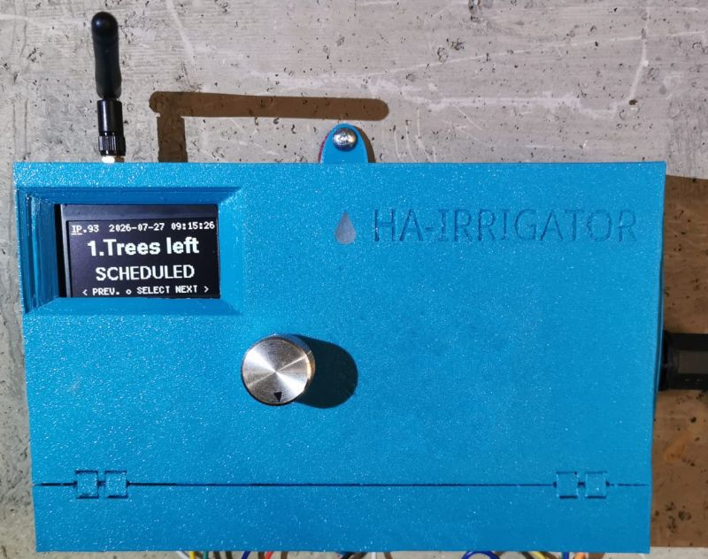

## Electronics

[Schematics](schematics.pdf)

ESP32 DevKit Pinout:

### Parts

| Ref             | Part                              | Description                                                                          | Qty |
|-----------------|------------------------------------|---------------------------------------------------------------------------------------|-----|
| U1              | ESP32-WROOM-32U dev kit           | Main microcontroller board                                                            | 1   |
| U2              | DS3231M                           | I2C real-time clock module                                                            | 1   |
| BT1             | CR2032                            | 3V coin cell, RTC backup battery                                                       | 1   |
| J6              | SSD1309 OLED 2.4"                     | I2C OLED display module                                                               | 1   |
| SW1             | Rotary encoder w/ push-button     | User input for menu navigation                                                         | 1   |
| U4              | AC-DC PSU, 230VAC → 5VDC 3A       | Powers ESP32, logic and display                                                        | 1   |
| —               | Transformer, 230VAC → 24VAC       | Powers valves relay coils (Eco wiring only)                                            | 1   |
| L1, L2          | HWCT-5A/5mV current clamp sensor  | Non-invasive AC current sensing — L1 on 24VAC (valves), L2 on 230VAC (pump)            | 2   |
| J1–J3           | 4-channel 5V relay module         | 12 relays total: 11 valves + 1 pump ("Relays group 1/2/3")                             | 3   |
| D1–D24          | 1N4003 diode                      | Only for non-opto-isolated ("red") relay modules; use a jumper instead on opto ("blue") modules | 24 (optional) |
| D25             | Blue LED, 5mm                     | Status/fault indicator                                                                | 1   |
| R1–R3, R8, R9, R12–R25 | 10kΩ resistor               | Pull-ups: rotary encoder, current sensors, relay inputs                               | 19  |
| R4, R5, R7, R11 | 100Ω resistor                     | Rotary encoder and current sensor signal conditioning                                  | 4   |
| R6, R10         | 1kΩ resistor                      | Current sensor burden resistor (24VAC / 230VAC)                                        | 2   |
| R26             | 30Ω resistor                      | LED current limiting                                                                   | 1   |
| C1, C4, C5      | 100nF capacitor                   | Rotary encoder debounce                                                                | 3   |
| C6, C7          | 10nF capacitor                    | Rotary encoder debounce                                                                | 2   |
| C2, C10         | 100µF 10V capacitor               | Decoupling (ESP32, OLED)                                                               | 2   |
| C8, C9          | 10µF 10V capacitor                | Current sensor filtering (24VAC / 230VAC)                                              | 2   |
| C3              | 470µF 16V capacitor               | PSU output smoothing                                                                   | 1   |
| J4, J5          | 19-pin headers                    | ESP32 devkit sockets                                                                   | 2   |
| J7–J9           | Screw terminal / JST connectors   | Mains AC in, PSU AC in, PSU DC out wiring                                              | 3   |

### About the relay modules
There are 2 types of "cheap" 4x relay modules on the market:

| PCB color | Blue | Red |
|--|--|--|
| Connectivity | 0.1" header | Terminal blocks |
| Active | Low | Configurable with jumper High/Low |
| Dimensions | Slightly larger | Slightly smaller |
| Optocopler | Less sensitive | Very sensitive |
| Assembly | simple | requires voltage drop diodes |

Red boards require volrage drop diodes to set the optocouplers in high state (non-active) when the MCU is high. All boards require pullups.

## Mechanical design

- [Base](irrigator%20box.stl)
- [Lid](irrigator%20lid.stl)

## Installation wiring

In industrial irrigators the 24VAC transformer is often integrated into the irrigator. This reduces the customer flexibility where to mount the irrigator and what type of valves to use. Also, always connected transformer has parasitic current consumptions which hits customer wallet and hurts to the ecology. Our irrigator allows using any 24VAC transformer. It can be mounted on DIN rail or standalone. And it can be driven together with pump, i.e. it is not always connected to mains. This means **more flexibility, less electricilty bill, and less environment impact**.

## Antenna

Wi-Fi reception is critical only for automatic watering adjustment by the weather and for Home Assistant integration. HA-Irrigator can work without Wi-Fi too.

However, for the sake of installation flexibility, the antenna has separate SMA connector. This allows to install the irrigator practically in any place and run the low-attentuating coaxial cable (type of LMR-240 or HF-240) for up to 10 meters. The antenna then, can be placed in the area with good Wi-Fi signal when the irrigator itself can be even in concrete bunker.

### Simple

### Eco

## Current sensing

There are only 2 current sensors in the irrigator:
- For the pump, 220-240VAC, high current up to 12A.
- For valves, 24VAC, sub-amper current, typically 250mA.

The current measurement is not mandatory for the irrigator functionality. However, it can be useful to detect overcurrent and under current events:
- Overcurrent:
  - Pump blocked.
  - Valve wiring short circuit.
- Undercurrent: circuit discontinuity resulting non-fucntioning pump and/or valve.

In both cases there is a risk of over-drying of your garden.

One valve current sensor is enough for 11 valves because valves are never opened together, only 1 zone works at every given moment. So it is easy to correlate which valve is malfunctioning.

The current sensing becomes functional only after [current sensor calibration](../docs/usage_irrigator.md#current-sensor-calibration-explained).

### Current sensor sensitivty

The schematics is built to provide the follwing current sensitivity:
| Sensor  | Sensitivity, mV/mA | Sensitivity, mV/A | Saturation (ceiling), A |
|--|--|--|--|
| Valve | 0.82 | 820 | 1.4 |
| Pump | 0.047| 47 | 24.5 |

This means, having `CURRENT_CALIBRATION_MIN_BASE_LEVEL = 30` will fail the calibration of valve which consumes less than 36 mA and the pump that draws less than 640 mA.

## Water flow sensing

### Flow meter: TUF-2000M

An ultrasonic clamp-on flow meter — no pipe-cutting install, reads flow rate and totalized volume over Modbus RTU on RS-485. It also carries its own onboard relay (OCT), configurable locally on the meter to trip on a flow-rate or totalizer threshold — that relay is meant to drive the shut-off valve directly as a hardware failsafe (see below), independent of the ESP32/Wi-Fi being alive.

### RS-485 GPIOs

Every strapping-safe, output-capable GPIO is already claimed by zones/pump/LED/rotary/ADC/I2C (see [board_config.h](../include/board_config.h)), and GPIO0/1/3 are off-limits (factory-reset button, and `Serial`/flashing). That leaves only GPIO2 and GPIO12 — both ESP32 boot-strapping pins:

| Signal | PIN |
|--|--|
| TX → converter TXD | 2 | 
| RX ← converter RXD | 36 | 
| DE/RE | — (unused/automatic) | 
| GND | GND | 
| VIN | 3V3 |

### RS-485 converter: Waveshare TTL TO RS485 (C)

Picked over a plain MAX485-style breakout for two reasons:
- **Galvanic isolation.** This cable run parallels mains wiring through the garage; the module isolates the RS-485 bus side (both power and signal, via an onboard isolated DC-DC plus a digital isolator) from the ESP32's own logic and ground, so an induced spike on the bus has no metallic path to the MCU even if it gets past the onboard TVS clamp first.
- **Automatic direction switching**, built into the chip — no DE/RE control needed, so the link only spends the 2 GPIOs above instead of 3.

Also has onboard 120Ω termination (enabled by soldering a jumper) and 200W surge / 6kV ESD protection on the bus side. TTL-side pinout: VCC / TXD / RXD / GND (to the ESP32's 3.3V, GPIO2, GPIO36, GND); RS-485 side: A+ / B- / PE.

### Wiring the RS-485 cable

- Shielded twisted pair for A/B.
- Land the shield on the converter's **PE** terminal, at the ESP32 end only — don't also ground it at the flow meter end (that turns the shield into a ground-loop path), and don't bridge PE to the TTL-side GND (that defeats the isolation).
- Run a common GND wire alongside A/B out to the flow meter anyway, so both ends' transceivers share a reference within their common-mode range.

### Why the 120Ω terminator matters

RS-485 is a shared differential line; an un-terminated cable end reflects a fast signal edge back down the wire instead of absorbing it, corrupting bytes — worse at higher baud rates or longer runs. A 120Ω resistor at each of the two *physical ends* of the bus (matched to the cable's characteristic impedance) soaks up the edge instead of reflecting it. Enable it only at the two endpoints, never at an intermediate device on a multi-drop run — extra resistors along the way just overload the driver and attenuate the signal for everyone.

### Room for more RS-485 devices later

RS-485/Modbus is multi-drop: a shut-off valve controller or any other Modbus RTU device can join the same A/B pair later with its own slave ID — no extra ESP32 pins or a second converter needed, they all share this one bus.

### Shut-off valve strategy

Prefer the TUF-2000M's own relay, configured locally (flow-rate or totalizer threshold), as the failsafe that closes a master shut-off valve even when the ESP32 or Wi-Fi is down — the same "don't trust the network for safety-critical stuff" principle the current-sensing overcurrent checks already follow. Poll flow readings over Modbus in firmware as well, for HA reporting/logging and for schedule-aware logic the meter alone can't know (e.g. unusually high volume mid-cycle for whichever zone is currently running).
